# Exploring Performance–Energy Trade-offs with Energy Roofline Models on a Hybrid Laptop CPU

*Advanced Computer Architecture course project. Measurements: Sai Abhinav; modelling, analysis and report: Nikhil. All numbers below are regenerated by `analyze.py` / `compare.py` from the data in `data/sai-Victus-by-HP-Gaming-Laptop-15-fa1xxx/`.*

## 1. Introduction

For most of computing history, performance tuning meant reducing run time, and energy was treated as something that would follow. That assumption no longer holds automatically. Batteries, data-centre electricity bills and thermal design limits make energy a first-class cost, and modern processors spend it in ways that are not proportional to time: they change clock and voltage on the fly, they share a power budget between cores, and they burn a sizeable amount of power simply by being switched on.

This project asks one question: **on a modern multicore CPU, does making code faster also make it more energy-efficient?** To answer it we use the *energy roofline* model of Choi et al. [1], with the extensions from their follow-up study [2]. We fit the model to measurements from an Intel Core i5-13420H laptop processor, test it on three real kernels, and use it to study how data reuse and thread count affect time, energy and operations per joule. We also repeat the measurements with turbo boost disabled. That second setting gives the most important result of the study: the model's verdict holds within each setting but cannot choose between them.

## 2. Background: the energy roofline model

### 2.1 Algorithm and machine parameters

An algorithm is described by two numbers: its work **W** (floating-point operations) and its traffic **Q** (bytes moved between main memory and the processor). Their ratio, the **arithmetic intensity I = W/Q** (flop/byte), is the x-axis of every plot in this report. The machine is described by the time per flop τ_flop = 1/(peak flop/s) and the time per byte τ_mem = 1/(peak bandwidth), plus three energy constants: the energy per flop ε_flop, the energy per byte ε_mem, and a constant power π₀ that is drawn for as long as the program runs.

| Symbol | Meaning | Unit |
|---|---|---|
| W, Q, I | flops, DRAM bytes, intensity W/Q | flop, B, flop/B |
| τ_flop, τ_mem | time per flop / per byte (inverse peaks) | s |
| B_τ = τ_mem/τ_flop | time balance (ridge point of the roofline) | flop/B |
| ε_flop, ε_mem | energy per flop / per byte | J |
| π₀ | constant power | W |
| B_ε = ε_mem/ε_flop | energy balance | flop/B |
| ε₀ = π₀·τ_flop | constant energy charged per flop at peak rate | J |
| η_flop = ε_flop/(ε_flop+ε₀) | share of a flop's energy that is not constant power | – |
| B̂_ε(I) | effective energy balance (includes π₀) | flop/B |
| Δπ | usable power above π₀ (power cap, paper 2) | W |

Paper 1's Table I gives the unit of B_ε as "flops per Joule". Since B_ε is a ratio of two energies per unit (J/B divided by J/flop), its unit is **flop/byte**, the same as B_τ and I. We treat the table entry as a typo.

### 2.2 Time, energy and power

The model assumes that computation and data transfer overlap perfectly, so the slower of the two sets the run time:

> **T = max(W·τ_flop, Q·τ_mem) = W·τ_flop · max(1, B_τ/I)**

Kernels with I < B_τ are memory-bound and those with I > B_τ are compute-bound; plotted as flop/s against I, this gives the classic roofline with a sharp corner at B_τ.

Energy cannot overlap: every flop and every byte is paid for, and the constant power is paid for the entire run:

> **E = W·ε_flop + Q·ε_mem + π₀·T**

Without π₀, energy efficiency W/E = 1/(ε_flop + ε_mem/I) is a smooth curve, the **arch line**. It reaches half of its maximum at I = B_ε, where flops and bytes cost the same energy. With π₀ > 0, the authors fold the constant energy into an effective per-flop cost ε_flop + ε₀ and an intensity-dependent effective balance

> **B̂_ε(I) = η_flop·B_ε + (1 − η_flop)·max(0, B_τ − I)**

so that E = W·(ε_flop + ε₀)·(1 + B̂_ε(I)/I). The intensity at which the arch line reaches half of its peak is the fixed point I = B̂_ε(I); we call this value simply B̂_ε. Average power P = E/T, plotted against I, is the **powerline**: it peaks at I = B_τ, where flops and bytes are both running at full rate, and falls towards flop-only or memory-only power on either side.

### 2.3 Balance gap and race-to-halt

Comparing the two balance points tells an algorithm designer whether time and energy optimisation pull in the same direction. If B̂_ε > B_τ there is a **balance gap**: kernels with B_τ < I < B̂_ε are already compute-bound in time but still memory-bound in energy, so further energy savings require raising intensity even though the run time will not improve. If B_τ > B̂_ε, any kernel that is fast (compute-bound in time) is also within a factor of two of the best possible energy efficiency, so running as fast as possible and then idling (**race-to-halt**) is a sound energy strategy. A large π₀ lowers η_flop and therefore B̂_ε, which favours race-to-halt. Paper 1 found exactly this on an Intel i7-950 desktop (double precision: B_τ ≈ 2.1, B̂_ε ≈ 1.1; ε_flop ≈ 670 pJ, ε_mem ≈ 795 pJ/B, π₀ ≈ 122 W). The authors argued that if constant power and core overheads shrank in future hardware, the gap could open and race-to-halt would stop working.

### 2.4 Extensions from paper 2

Paper 2 [2] evaluates the model on twelve platforms and adds four things we use (paper 2 writes the constant power as π₁; we keep π₀ throughout):
1. **Power cap.** If only Δπ watts above π₀ are available, operations must slow down when they would draw more. The time becomes T = max(W·τ_flop, Q·τ_mem, (W·ε_flop + Q·ε_mem)/Δπ), which flattens the powerline at π₀ + Δπ and rounds off the roofline corner.
2. **Cache-level energies.** Running the intensity benchmark on working sets that fit in L1, L2 or L3 gives an energy per byte for each level. These are **inclusive** costs: the energy of an L2 access includes passing the data through L1 and the instruction overheads of the access.
3. **Random access.** Pointer chasing costs more than ten times the streaming energy per byte. We did not measure this.
4. **Constant power dominates.** On 7 of the 12 platforms π₀ was more than half of peak power, and within a platform power varied by less than 2× across intensities.

## 3. Experimental setup

**Hardware.** HP Victus 15 laptop with an Intel Core i5-13420H (Raptor Lake-H). The CPU is *hybrid*: 4 performance cores (Golden Cove, 2-way SMT, logical CPUs 0–7, up to 4.6 GHz) and 4 efficiency cores (Gracemont, no SMT, CPUs 8–11, up to 3.4 GHz); AVX2 + FMA, no AVX-512. Caches: 48 KB L1d per P-core and 32 KB per E-core (320 KB in total), 1.25 MB L2 per P-core plus 2 MB shared by the E-cores (7 MB), 12 MB shared L3. 15 GB of DDR memory on two controllers. Linux Mint 22 (kernel 6.8), gcc 13.3 with `-O3 -march=native -fopenmp`. The laptop ran on AC power with the *performance* platform profile, and the RAPL limits were PL1 = 45 W (56 s) and PL2 = 90 W. Theoretical double-precision peak at maximum turbo is 4×4.6 GHz×16 + 4×3.4 GHz×8 ≈ 403 GFLOP/s; at base clocks (2.1 / 1.5 GHz) it is ≈ 182 GFLOP/s.

**Energy measurement.** Energy comes from the RAPL *package* counter (`intel-rapl:0`), read before and after the timed region. This CPU exposes **no DRAM domain**, so DRAM energy is excluded throughout. The paper's measurements were taken at the power supply and include DRAM, motherboard and other components. The *psys* domain on this laptop does not track load and was ignored. Idle package power was 2.7–2.9 W.

**Kernels.**
- *Synthetic intensity kernel* (`bench.c`): for every double of an array, load it, apply K dependent FMAs and accumulate. W = 2K flops and Q = 8 bytes per element, so **I = K/4**, varied from 0.25 to 128.
- *Triad* `a[i] = b[i] + s·c[i]` on 32 M doubles (I ≈ 0.08).
- *Matrix multiply* C += A·B, n = 2048: a naive i-k-j loop and a blocked version with tile b ∈ {32, 64, 128}. For these real kernels **Q was measured** with the memory-controller counters (`uncore_imc_free_running_*/data_read,data_write/`). Two runs with different repetition counts were differenced and idle background traffic subtracted, and the measured Q was fed to the kernel. The analytic estimate for the naive kernel (8n³ bytes, B re-streamed for every row) was **5× too high**: the eight threads share B through the L3 cache. The real intensity of the naive kernel is 1.28 flop/B, not 0.25.

**Experiments.** Exp 1: K = 1…512 on 8 threads (all physical cores), 512 MB array in DRAM. Exp 2 (data reuse): K ∈ {1, 2, 4, 8, 16, 64} with working sets of the *total* capacity of each level (L1 160 KB, L2 3.5 MB, L3 9.1 MB, DRAM 512 MB). The L3 set is larger than all L2 caches combined, so it is genuinely served from L3. Exp 3 (threads): 1, 2, 4, 6, 8, 12 threads at I = 0.25, 4 and 64. Exp 4: the real kernels on 8 threads.

**Method.** Each configuration runs for at least 1 s (RAPL updates about every 1 ms, so the quantisation error stays below 0.1%) and is repeated 3 times; we use the median, which is robust to a single disturbed repeat. Threads are pinned (`OMP_PROC_BIND=close`, `OMP_PLACES=cores`; `threads` for 12). Places fill in core-id order, so 1–4 threads use only P-cores, 6 adds two E-cores, 8 uses all physical cores and 12 adds the SMT siblings. The hybrid cores required **load balancing**: with an equal static split, 8 threads were slower than the 4 P-cores alone. Each thread therefore owns a slice sized to its measured speed (P:E ≈ 1.43:0.58 when compute-bound). A cool-down of 1.5× the run time follows every run. A per-run **throttle detector** (thermal-throttle counters, PL1 reductions, package temperature) retries a throttled run up to three times. Rows that were still throttled are flagged in `run_flags.csv`, and **analyze.py drops them before every fit**. Configurations whose three repeats were all throttled are shown hollow or hatched in the figures. Turbo-on run 1 had 21 of 171 rows flagged (hot reuse configurations, tiled matmul b = 64/128), run 2 had 28, and the turbo-off run had none. A second turbo-on run (same day) and a turbo-off run (`no_turbo = 1`: P-cores capped at 2.1 GHz, E-cores at 1.5 GHz; Exp 1, 2, 4) complete the dataset.

**Fitting.** Following paper 1, we divide the energy equation by W and fit E/W = ε_flop + ε_mem·(Q/W) + π₀·(T/W) to the ten Exp 1 medians by non-negative least squares. The peak rates are the highest measured flop/s and byte/s in Exp 1. Per-level energies hold ε_flop and π₀ fixed and fit the remaining energy against Q, with relative-error weights so the low-K points (where data movement dominates the energy) carry the fit. Δπ for the capped model is the highest measured Exp 1 power minus π₀. A synthetic-data test (`make_fake_data.py --check`) confirms that the fitting code recovers planted parameters exactly when there is no noise, and that it drops flagged rows. With 2% noise, the medians over nine seeds stay within 5% of the planted values.

## 4. Results

### 4.1 The machine model and the race-to-halt verdict

| | Turbo on, run 1 | Turbo on, run 2 | Turbo off | i7-950 (paper 1, DP) |
|---|---|---|---|---|
| Sustained peak (GFLOP/s) | 361.7 | 367.7 | 165.0 | 49.7 |
| Sustained bandwidth (GB/s) | 40.1 | 40.0 | 36.4 | 18.9 |
| ε_flop (pJ/flop) | 99.8 | 100.8 | 34.9 | 670 |
| ε_mem (pJ/B) | 641 | 627 | 219 | 795 |
| π₀ (W) | 23.2 | 23.6 | 7.9 | 122 |
| B_τ (flop/B) | **9.03** | 9.18 | **4.53** | ≈ 2.1 |
| B_ε (flop/B) | 6.43 | 6.22 | 6.28 | ≈ 1.2 |
| B̂_ε (flop/B) | **5.35** | 5.31 | **3.34** | ≈ 1.1 |
| η_flop | 0.61 | 0.61 | 0.42 | – |
| Peak energy efficiency (GFLOP/J) | 6.10 | 6.06 | 12.09 | ≈ 0.34 |
| Energy error, median / max | 1.7% / 4.9% | 1.9% / 5.1% | 1.6% / 7.2% | – |
| Time error, median / max | 1.3% / 15.3% | 3.8% / 10.9% | 2.3% / 18.7% | – |

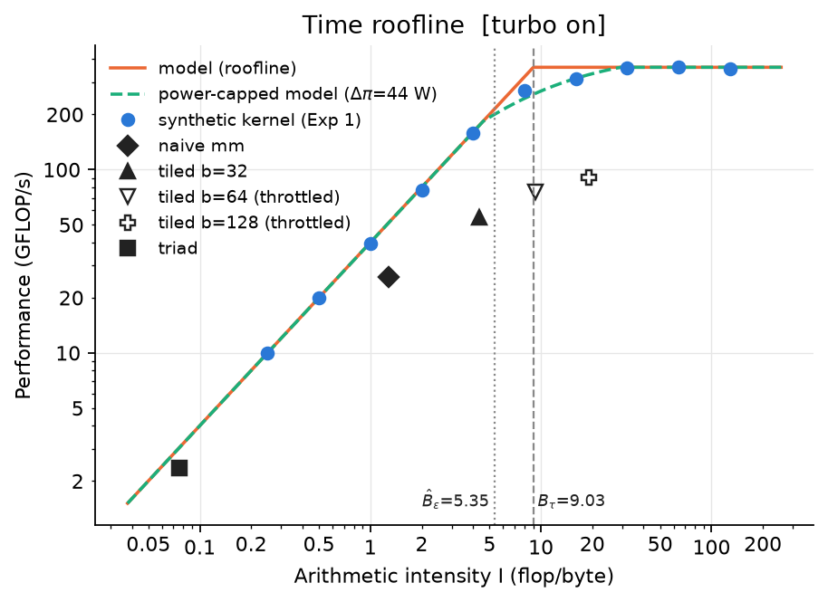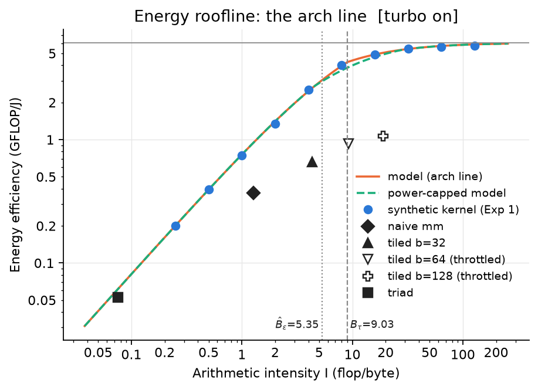

Figure 1. Time roofline (left) and energy arch line (right), turbo on. Blue dots: synthetic kernel; black markers: real kernels (hollow = every repeat throttled); green dashes: paper 2's power-capped model.

**The model describes this CPU well.** With three fitted constants and two measured peaks, it predicts the energy of the intensity sweep with a median error of 1.7% (maximum 4.9%) and the time with a median error of 1.3% (Figures 1 and 3). Run 2 reproduces every fitted parameter within 3.3%. The fitted ε_flop and ε_mem in run 1 are identical to the independent check in the measurement notes. **Race-to-halt holds:** B_τ = 9.03 > B̂_ε = 5.35. Every kernel that is compute-bound in time is already within a factor of two of the best possible energy efficiency, and the measured arch line shows this: at I = 16 the kernel reaches 4.9 of the 6.1 GFLOP/J asymptote.

**The balance gap has narrowed since 2013.** Compared with paper 1's i7-950, our flop energy is 6.7× lower (100 vs 670 pJ), while the byte energy has hardly changed (641 vs 795 pJ/B, and ours does not even include DRAM). B_ε has therefore risen from about 1.2 to 6.4, approaching B_τ, as paper 1 suggested it might. With turbo off, B_ε (6.28) already *exceeds* B_τ (4.53). If π₀ were zero there would be a balance gap between I ≈ 4.5 and 6.3, and race-to-halt would hold only because constant power (η_flop = 0.42) pulls B̂_ε down to 3.34. Paper 1 saw the same situation on its GPU in double precision.

**π₀ is not idle power.** The fitted constant power (23.2 W) is eight times the idle package power (2.86 W). It is the power of all cores and the uncore being awake at full clock while the work happens, whatever operations are executing. Paper 1 made the same observation (122 W fitted vs ≈ 40 W idle on its GPU).

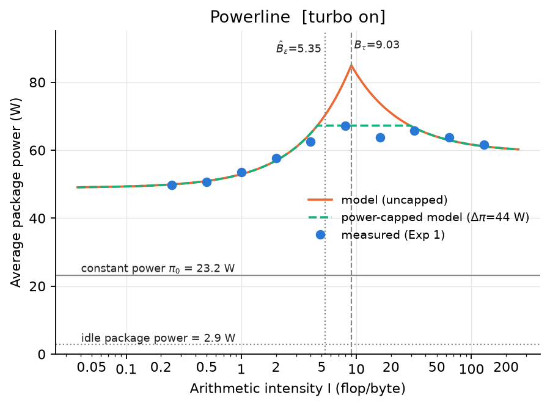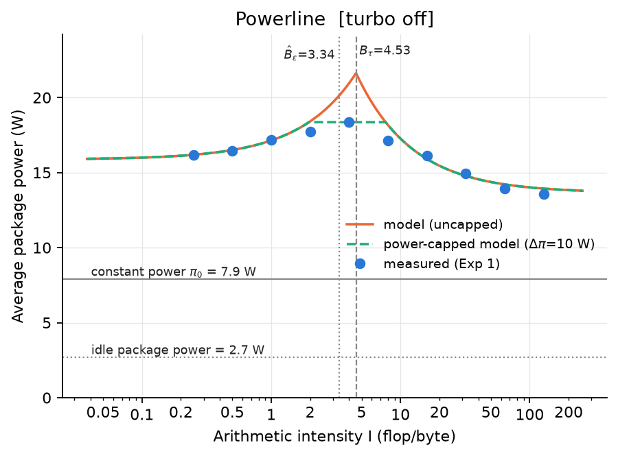

Figure 2. Powerlines, turbo on (left) and off (right). With turbo on the uncapped model asks for 85 W at Bτ, but the laptop never drew more than 67 W in Exp 1; the capped model (green) follows the plateau.

**Power cap.** The uncapped powerline (Figure 2) predicts 85 W at I = B_τ, because it assumes the flop units and the memory system can both run at full speed simultaneously. The laptop never drew more than 67.2 W in Exp 1 (70.7 W in run 2). Its sustained limit is PL1 = 45 W, but the runs last only about 1 s, within the PL2 = 90 W window. Thermal limits still apply: the package reaches 95–98 °C within one or two seconds. Accordingly, the two points nearest the corner (I = 8 and 16) sit 14–15% below the roof. With Δπ = 67.2 − 23.2 = 44.0 W, the capped model of paper 2 removes most of the power error (maximum 20.4% → 5.5%) and lowers the median time error (1.3% → 0.9%). However, it *over*-corrects at I = 8: it predicts a run 11% slower than measured, and energy 11% too high. The cap assumes operations keep their full energy cost and are merely delayed, whereas the CPU meets its limit by lowering frequency and voltage, which makes each operation cheaper. With turbo off, where the clocks stay at base and power is far below every limit, the capped model fits well (maximum energy error 7.2% → 2.5%, time 18.7% → 8.2%).

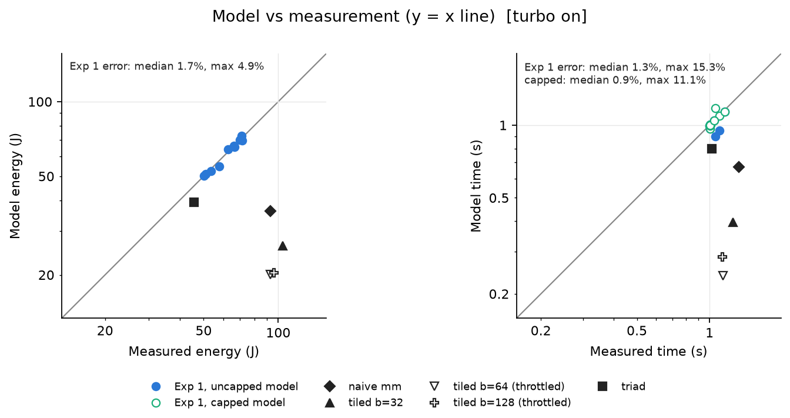

Figure 3. Model vs measured energy (left) and time (right), turbo on, log-log axes; the grey line is y = x. Real kernels are shown for reference (they are not part of the fit).

### 4.2 Real kernels on the model

The real kernels (black markers in Figure 1) all lie *below* both the roofline and the arch line, as a bound-type model expects. Triad, a pure streaming kernel, comes closest: it takes 1.3× the time the roof allows, and the energy model evaluated with its measured run time is within 3% (turbo on) and 2% (turbo off). The matrix multiplies take 2–5× the time the roof allows and use 1.4–2.4× more energy than the model predicts *even when given their measured time* (1.8–2.4× with turbo on, 1.4–1.9× with turbo off). Their data are reused from L1 and L2 over and over, and that traffic is not in Q, which counts only DRAM bytes. Paper 1 hit the same limitation with its fast-multipole kernel and fixed it by adding a cache-access energy term. The model is therefore a reliable upper bound for performance and efficiency, and an accurate predictor only for kernels whose traffic is dominated by DRAM.

### 4.3 Data reuse

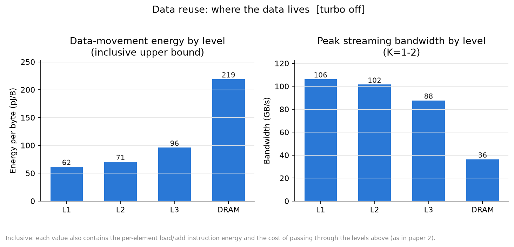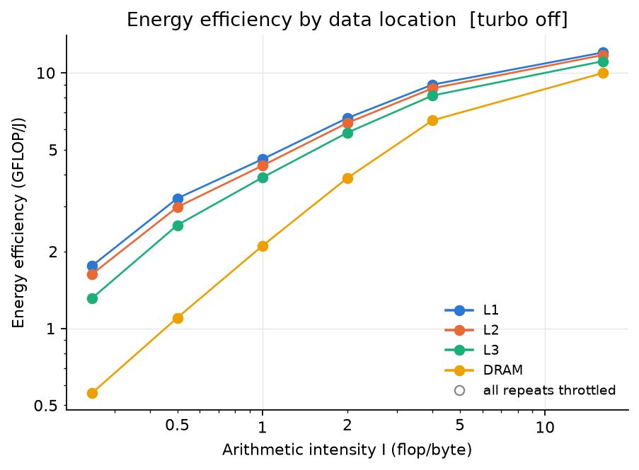

Figure 4. Data reuse, turbo off (no throttled rows). Left: inclusive energy per byte by level and peak streaming bandwidth. Right: energy efficiency against intensity for each data location.

Keeping data closer to the core lowers the energy per byte at every level (Figure 4, turbo off): **L1 62 < L2 71 < L3 96 < DRAM 219 pJ/B**. These are inclusive upper bounds: each value also contains the load and add instructions executed per element, which is why L1 is far above the few pJ per access of an SRAM array. The relative costs are what matter: an L1 byte costs 0.28× a DRAM byte, L2 0.32× and L3 0.44×. With turbo on, L1 (195 pJ/B, 0.30×), L3 (284, 0.44×) and DRAM (643) show the same ratios. Turbo-on L2 (275 pJ/B) is unreliable: its three most data-dominated configurations (K = 1, 2, 4) were throttled in every repeat and had to be excluded. At low intensity the energy efficiency differs by up to 4× between L1 and DRAM (0.81 vs 0.20 GFLOP/J at I = 0.25, turbo on). The levels converge at high intensity, where flops dominate the energy.

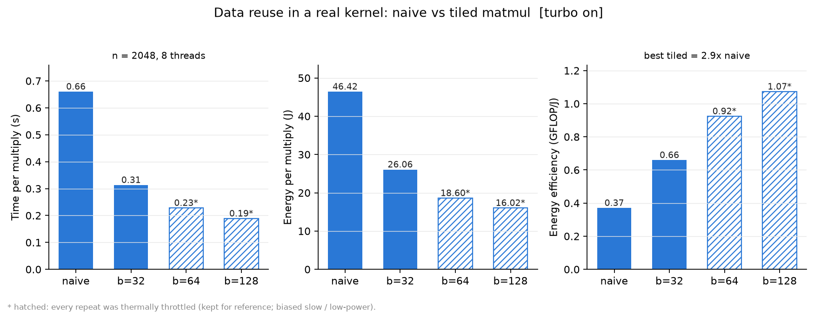

Figure 5. Data reuse in a real kernel, turbo on: naive vs tiled matrix multiply (n = 2048, 8 threads). Hatched bars: every repeat thermally throttled.

Tiling turns the same effect into a real optimisation (Figure 5). The 128-wide tiles raise the DRAM intensity from 1.3 to 19 flop/B, cut the run time 3.5× and the energy 2.9×. The **energy efficiency improves 2.9× with turbo on and 2.2× with turbo off** (where all configurations are clean). Here faster and greener coincide, because tiling removes DRAM traffic, the expensive component of both. The turbo-on b = 64 and b = 128 numbers come from throttled runs, which makes them slightly pessimistic for speed.

### 4.4 Thread scaling

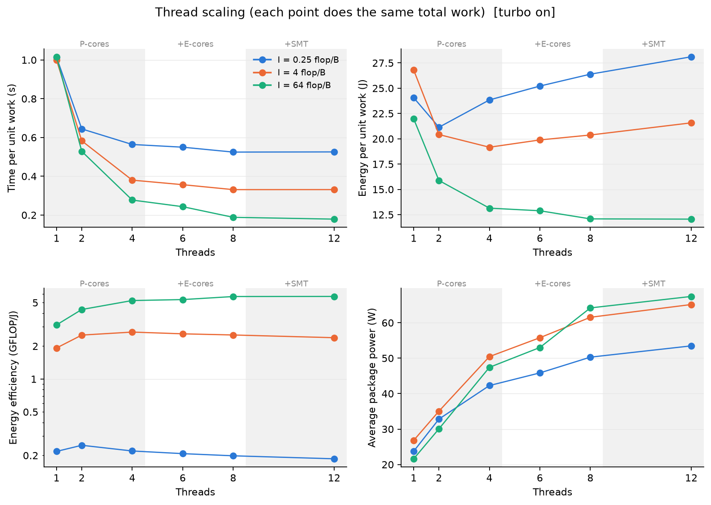

Figure 6. Thread scaling at I = 0.25, 4 and 64 flop/B (turbo on); every point does the same total work. Shaded bands mark where threads are added on P-cores, E-cores and SMT siblings.

The thread count that minimises energy depends on intensity (Figure 6):

| I (flop/B) | Fastest at | Most energy-efficient at | GFLOP/J at best vs at fastest |
|---|---|---|---|
| 0.25 (memory-bound) | 8 threads | **2 threads** | 0.25 vs 0.20 |
| 4 (near balance) | 8 threads (12 in run 2) | **4 threads** | 2.69 vs 2.53 |
| 64 (compute-bound) | 12 threads | 12 threads | 5.70 |

For the memory-bound kernel, two P-cores already reach 80% of the best speed (bandwidth saturates at about four threads). Every additional thread adds 2–5 W of power but almost no speed, so energy rises from 21 J to 28 J for the same work. Extra threads help energy only when they also reduce time enough to save constant energy, which happens only for compute-bound code. Two effects in the figure lie outside the model. Adding E-cores (6–8 threads) gives smaller gains per thread than adding P-cores, because they are slower and run at a different clock. SMT (12 threads) adds power but almost no speed for this FMA-bound kernel. The model assigns one ε_flop and one peak rate to the whole chip, so it cannot represent a heterogeneous mix of cores or contention for shared bandwidth.

### 4.5 Where the energy goes

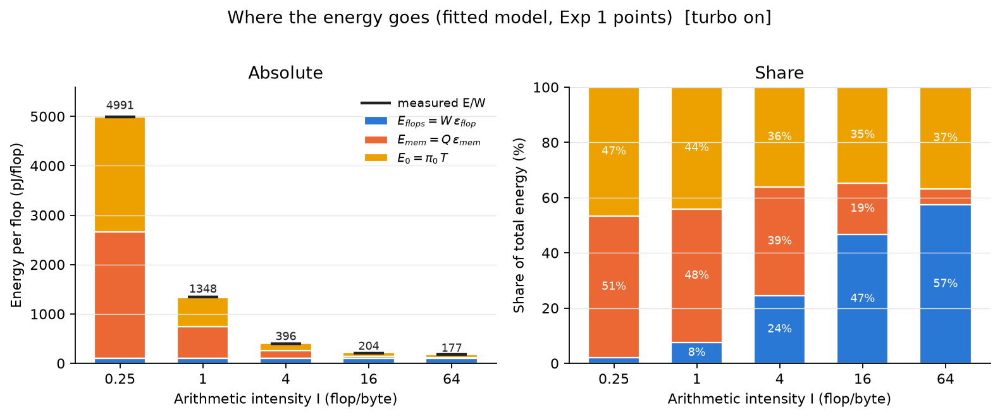

Figure 7. Energy per flop split into flops (W·ε_flop), memory (Q·ε_mem) and constant energy (π₀·T) at five intensities, turbo on. Black ticks: measured E/W.

Constant energy is 35–47% of the total at every intensity with turbo on (Figure 7), and 43–56% with turbo off. At low intensity, memory and constant energy split the bill almost evenly and flops are negligible (2%). At I = 64 flops dominate (57%), but more than a third is still spent just keeping the chip on. This large, time-proportional term is what makes race-to-halt attractive: any speed-up removes part of it. It also means π₀ needs reducing more than any other parameter, which paper 2 concluded across its twelve platforms.

### 4.6 Turbo on vs turbo off: the main finding

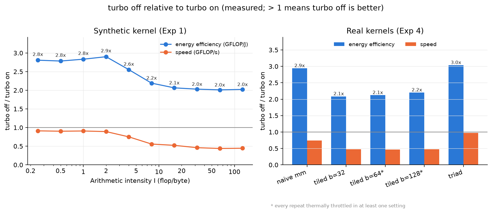

Figure 8. Measured turbo-off / turbo-on ratio of energy efficiency and speed for the synthetic kernel (left) and the real kernels (right). Overlaid arch lines and rooflines for both settings are in figures/comparison/.

Disabling turbo makes **every kernel 2.0–2.9× more energy-efficient at every intensity** (Figure 8): peak efficiency rises from 6.1 to 12.1 GFLOP/J. The cost in speed depends on intensity. Compute-bound code runs at 0.44–0.46× its turbo speed and gains 2.0× in efficiency. Memory-bound code loses only about 9% of its speed, because DRAM bandwidth barely depends on core clock, and gains 2.8–2.9×. The real kernels behave the same way: triad and naive matmul gain 3.0× and 2.9× for at most 26% lost speed, the tiled kernels 2.1–2.2×.

The fitted constants explain this. **All three energy constants drop by about a factor of three** (ε_flop 100 → 35 pJ, ε_mem 641 → 219 pJ/B, π₀ 23 → 8 W), which is roughly what the square of the voltage reduction would give. B_ε stays near 6.3: both ε_flop and the on-chip part of ε_mem scale with the same core and uncore voltage. B_τ halves (the flop rate halves, bandwidth falls only 9%), and B̂_ε falls from 5.35 to 3.34. The verdict is **race-to-halt in both settings**, yet the slower setting is twice as efficient. Racing to halt is the right advice *within* a fixed frequency and voltage, but not *across* frequencies. The model has no frequency or voltage in it: its constants are fitted at one DVFS state, so it cannot say which state to choose. Even so, refitting the model at each state predicts the efficiency gain accurately.

### 4.7 DRAM energy sensitivity

RAPL on this CPU reports package energy only, so the fitted ε_mem (641 pJ/B with turbo on, 219 pJ/B with turbo off) is the **CPU-side** cost of moving a byte from DRAM, which is a lower bound on the full cost. It *includes* the load instructions, the L1/L2/L3 caches, the ring interconnect, the memory controller and the CPU-side PHY. It *excludes* the DRAM devices themselves: cell activation and sensing, refresh, and the DIMM-side I/O. Time is unaffected (τ_mem, B_τ and the measured bandwidths stay the same); only the energy constants are incomplete.

How much missing energy would change the verdict? The arch line reaches half of its peak at B̂_ε = (η·B_ε + (1−η)·B_τ)/(2−η) when this value is below B_τ, and at B̂_ε = η·B_ε otherwise. Both cases reduce to one condition:

> **B̂_ε < B_τ ⟺ η·B_ε < B_τ ⟺ ε_mem < B_τ·ε_flop/η = B_τ·(ε_flop + ε₀)**

Adding an assumed DRAM-device energy x to ε_mem raises B_ε and B̂_ε linearly (Figure 9). DRAM background power Δπ₀ adds to ε₀, which *raises* the threshold, so it makes race-to-halt slightly more robust, not less:

| Setting | fitted ε_mem | B_τ | Largest x that keeps race-to-halt: +0 W / +1 W / +3 W | B̂_ε at x = 253 / 389 pJ/B |
|---|---|---|---|---|
| Turbo on | 641 pJ/B | 9.03 | **840** / 865 / 914 pJ/B | 6.46 / 7.05 (< 9.03) |
| Turbo off | 219 pJ/B | 4.53 | **156** / 183 / 238 pJ/B | 5.71 / 7.35 (> 4.53) |

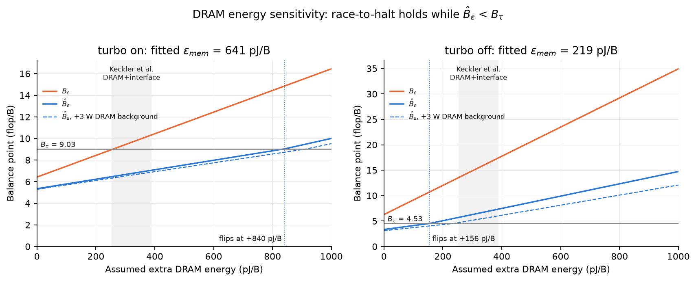

Figure 9. B_ε and B̂_ε against an assumed extra DRAM energy per byte; race-to-halt holds while B̂_ε stays under the B_τ line. Grey band: the DRAM + interface estimate of Keckler et al. quoted in paper 1 (253–389 pJ/B). Dashed: with 3 W of DRAM background power added to π₀.

Paper 1 quotes an estimate from Keckler et al. of 253–389 pJ/B for DRAM access, interface and wire transfer. Part of that (the controller and CPU-side interface) is already in our ε_mem, so the truly missing amount is smaller, but by an unknown margin. **With turbo on the verdict is robust:** flipping it needs more than 840 pJ/B of missing energy, over twice the *whole* Keckler estimate. Even then B̂_ε reaches only 6.5–7.1 against B_τ = 9.03. **With turbo off the verdict is fragile:** 156–238 pJ/B of DRAM energy would be enough, which is below the Keckler range, so a system-level measurement could show a balance gap at base clocks. In both settings the missing DRAM energy narrows the gap, since it raises B_ε towards (turbo on) or further past (turbo off) B_τ. The headline result does not depend on it: turbo off is 2–3× more efficient in package energy, and adding the same DRAM energy per byte to both settings would shrink but not reverse that advantage, because DRAM device energy does not depend on core clock.

## 5. Critique of the model

**Strengths.**
- *Very few parameters.* Five numbers (two peaks, three energies) predict energy to within 2% across a 500× range of intensities on a 2023 hybrid CPU that the model's authors never saw.
- *Algorithm-centred.* Everything is expressed through W, Q and I, which a programmer can estimate before writing code. The arch line tells you how much intensity you need to reach a target efficiency.
- *It explains race-to-halt* in terms of a measurable constant power, and predicts when it would stop working (B̂_ε > B_τ).
- *It extends cleanly.* Power caps and cache-level energies each add one term without changing the structure, and both proved useful here.
- *Validated widely.* Paper 1 tested it on two platforms and paper 2 on twelve, and our laptop fits as well as theirs did.

**Weaknesses, with evidence from our data.**
1. *Constant cost per operation assumes a fixed frequency and voltage.* Turbo changes all three energy constants by 3× (§4.6). The model cannot choose a DVFS state, which is exactly the decision that saved the most energy in our study.
2. *Power and thermal limits.* The uncapped model asks for 85 W the laptop cannot deliver. Paper 2's cap fixes the power but over-predicts the slowdown, because the real CPU lowers its frequency and voltage at the limit instead of delaying operations (§4.1). Thermal throttling also made 12–16% of the turbo-on rows unusable. A preliminary run without throttle detection measured K = 512 at 250–260 GFLOP/s and 31 W instead of 356 GFLOP/s and 62 W, all three repeats consistently wrong.
3. *Best-case overlap.* The max() in the time model overestimates performance near B_τ: our points there are 14–19% below the roof.
4. *Only DRAM traffic counts.* Kernels with heavy cache reuse (matmul) use 1.4–2.4× more energy than predicted even with their measured time (§4.2). An inclusive cache term, as in paper 2, is needed.
5. *π₀ is a catch-all and weakly identified.* It absorbs the uncore, the idle cores and leakage, and is 8× the idle power. In the regression it trades off against ε_mem and ε_flop, because T/W is proportional to Q/W in the memory-bound regime and constant in the compute-bound one. With 2% synthetic noise the fitted π₀ varied by ±20% between seeds, while the real data (≈ 0.5–1% noise) reproduced within 2%.
6. *No model of threads, heterogeneity or contention.* The P/E cores, SMT and bandwidth saturation shape Exp 3, but the model has one chip-wide peak and one ε_flop.
7. *Measurement boundary.* RAPL package energy omits DRAM, so our ε_mem is the on-chip cost of moving a byte (loads, caches, ring, memory controller). It is not comparable to the wall-socket costs in the papers. §4.7 shows the turbo-on verdict survives any plausible DRAM energy, but the turbo-off verdict would flip with 156–238 pJ/B of DRAM energy.
8. *Reads and writes, prefetching and random access are not distinguished.* Triad's measured traffic was only 0.83× the textbook count because the core avoids part of the write-allocate read.

**Limitations of this study.** One machine; package-only energy, so ε_mem is a lower bound and the turbo-off race-to-halt verdict is sensitive to it (§4.7); a same-day repeat rather than one after a reboot; a fit on the synthetic kernel only; throttled turbo-on configurations excluded or flagged; no thread experiment with turbo off.

**Open questions.** Paper 1 asked whether a balance gap (B̂_ε > B_τ) will appear in future hardware and break race-to-halt (O1). Holding our other constants fixed, the turbo-on verdict survives even at π₀ = 0 (B_ε 6.43 < B_τ 9.03), but the turbo-off verdict flips once π₀ falls below about 2.2 W, which is under the chip's idle package power. Paper 2 asked how far constant power can be reduced (O3); on our package it is still 35–43% of peak power and 3–8× the idle power. It also suspected that a power-capped chip does not keep a constant cost per operation (O5): our turbo-on constants cannot even reach the 18.4 W that turbo off draws, because their π₀ alone is 23.2 W, while turbo off meets that power by DVFS and is 2–3× more efficient. DVFS itself is the trade-off paper 1 set aside (O11), and it was the largest energy lever in our study. The full list is in `viva_guide.md`, section 7.

## 6. Conclusion

1. The energy roofline model fits this hybrid laptop CPU closely: the median energy error is 1.7% and the median time error 1.3%, and a repeat run agrees within 3%.
2. Race-to-halt holds within each setting: B_τ > B̂_ε with turbo on (9.03 > 5.35) and with turbo off (4.53 > 3.34). Faster code at a fixed clock is also more energy-efficient code. With turbo on this survives any plausible missing DRAM energy; with turbo off it would not survive more than about 160–240 pJ/B (§4.7).
3. Since 2013, flop energy has fallen about 7× while byte energy has barely moved, so B_ε has risen from ≈ 1.2 to ≈ 6.4. With turbo off it already exceeds B_τ, and only constant power (≈ 8× idle power) keeps race-to-halt valid.
4. Data reuse is the one optimisation that improves time and energy together: L1 < L2 < L3 < DRAM (62 / 71 / 96 / 219 pJ/B, turbo off), and tiling makes matmul 2.2–2.9× more energy-efficient.
5. The energy-optimal thread count is low for memory-bound code (2 threads at I = 0.25) and equal to the maximum only for compute-bound code.
6. **The answer to the research question is "yes, but only at a fixed frequency".** Turning turbo off makes every kernel 2–3× more energy-efficient at a cost of 9–56% in speed. Faster code is more efficient within one DVFS state, but the fastest setting is not the most efficient. Choosing the DVFS state is the decision that matters most, and the model in its current form cannot make it.

## References

[1] J. W. Choi, D. Bedard, R. Fowler, R. Vuduc, "A roofline model of energy," *Proc. IEEE IPDPS*, 2013, pp. 661–672.

[2] J. W. Choi, M. Dukhan, X. Liu, R. Vuduc, "Algorithmic time, energy, and power on candidate HPC compute building blocks," *Proc. IEEE IPDPS*, 2014, pp. 447–457.

[3] S. Williams, A. Waterman, D. Patterson, "Roofline: an insightful visual performance model for multicore architectures," *Commun. ACM* 52(4), 2009.

*How to reproduce every number and figure: see the README section "Analysis and report".*
